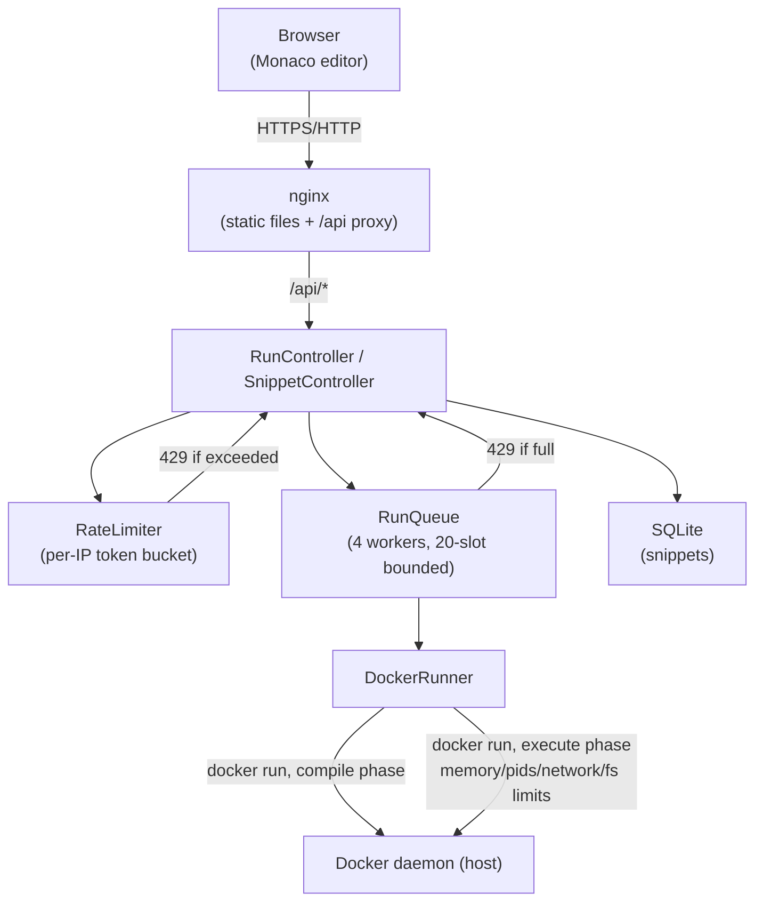

# Architecture

## Overview

## Request lifecycle: `POST /api/runs`

1. **Validation** (`RunController`): language is known, source isn't blank, source/stdin under 64 KB each (measured in bytes, not characters).
2. **Rate limiting** (`RateLimiter`): per-IP token bucket, 10 tokens, refilled at 10/minute. Exceeded → `429` before anything else runs.
3. **Queueing** (`RunQueue`): a `ThreadPoolExecutor` with 4 fixed workers and a 20-slot bounded queue. Full → `429` immediately, no waiting.
4. **Compile phase** (`DockerRunner`): the submitted code is written to a fresh, world-writable temp directory, then run in a container built from the matching `LanguageConfig` (e.g. `g++` for C++, a syntax check for Python/JS). A non-zero exit here (or a timeout) yields `COMPILE_ERROR` and the run phase is skipped.
5. **Run phase**: a second container runs the compiled binary (or the interpreter), this time with the full sandbox: memory limit, process limit, no network, read-only filesystem except a small `/tmp`, dropped Linux capabilities, no new privileges. A background timer kills the container if it exceeds the time limit; stdout/stderr are capped at 64 KB each.
6. **Verdict classification**: timeout → `TIME_LIMIT`; output capped → `OUTPUT_LIMIT`; exit code 137 → `MEMORY_LIMIT`; exit code 0 → `OK`; anything else → `RUNTIME_ERROR`.
7. The container is killed unconditionally after the process exits, regardless of why it exited (see `docs/decisions/002`).

## Snippet sharing

`POST /api/snippets` stores `{language, source, stdin}` in SQLite via plain `JdbcTemplate` (no ORM), keyed by an 8-character random id. `GET /api/snippets/{id}` reads it back. The frontend loads a snippet from `?id=...` in the URL on page load.

## Language support

Each language is a `LanguageConfig` record: a Docker image, a source filename, a compile command, and a run command. Adding a language means adding one `LanguageConfig` constant and one runner image — nothing else in `DockerRunner`, `RunController`, `RunQueue` or `RateLimiter` knows or cares which language is running. Five languages are supported this way: C++, C, Java, Python, JavaScript.

## Deployment

Everything runs via `docker-compose.yml`: a `backend` container (Spring Boot, built in a multi-stage Dockerfile) and a `frontend` container (nginx serving the built Vite app, reverse-proxying `/api/*`). The backend uses the host's Docker daemon directly — it does **not** run Docker-in-Docker. `docker-compose.yml` mounts the host's `/var/run/docker.sock` and `/tmp` into the backend container, so that when `DockerRunner` asks the daemon to mount a temp directory into a sandboxed container, the path resolves to the same location on the host where the daemon actually runs.

This project is intentionally not deployed to a public server; see the README and `docs/threat-model.md` for why.